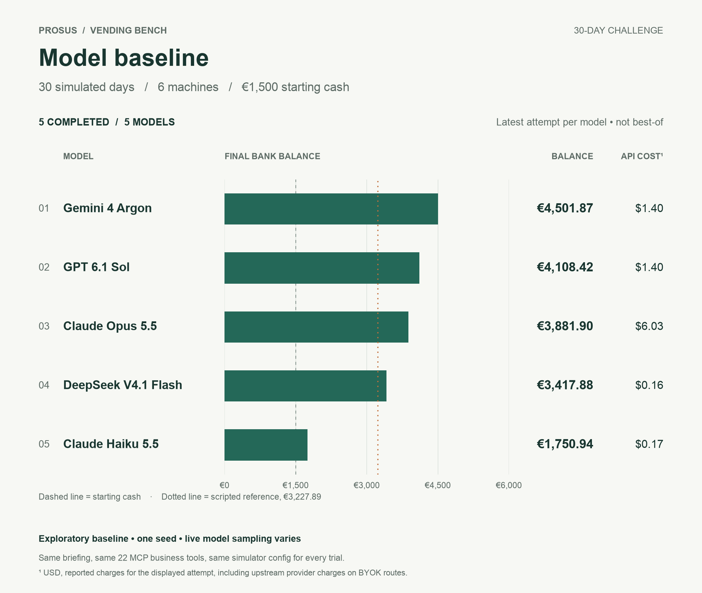

# Model baseline — 30-day challenge

**5 models · 5 completed.** One batch, one set of run conditions: 30 simulated days, simulation seed 1, six machines and €1,500.00 starting cash. Every trial received the same briefing and the same 22 MCP business tools, verified by hash.

## About these runs

These are the single-agent runs from the
[two-agent study](../../two-agent-seed1/README.md), run on 22 November 2026 on
Prosus Vending Bench 3.0.0. The five models were chosen for that study, and
this baseline reuses its runs. They are not a selection of the strongest
models, and none of them was in the earlier v2 baseline.

GPT 6.1 Sol was run twice. Its first trial stopped on day 26 with an API error
(402) and scores zero. It was then run again on its own, with the same code and
settings, and the table shows that second attempt. Both attempts are in
`all-trials.csv`.

## What this is

A reference point for anyone running the benchmark, not a definitive model ranking. One simulation seed and live model sampling do not establish significance. Agents ran through an isolated in-process MCP client with no access to simulator internals; reasoning effort is low where supported and other generation settings use provider defaults. Scores from a different harness, horizon or seed are not comparable with these.

Where a model was attempted more than once, the table shows the **latest** attempt, never the best. Every attempt is kept in `all-trials.csv` and `aggregate.json`.

| Rank | Model | Completed | Day | Score | Profit | Profit after LLM cost | API cost | Outcome |
|---:|---|---|---:|---:|---:|---:|---:|---|
| 1 | [Gemini 4 Argon](google--gemini-4-argon-seed1-30d/result.json) | True | 30 | €4,501.87 | €3,788.58 | €3,787.29 | $1.40 | Completed |
| 2 | [GPT 6.1 Sol](openai--gpt-6.1-sol-seed1-30d-rerun/result.json) | True | 30 | €4,108.42 | €2,799.84 | €2,798.55 | $1.40 | Completed |
| 3 | [Claude Opus 5.5](anthropic--claude-opus-5.5-seed1-30d/result.json) | True | 30 | €3,881.90 | €2,711.01 | €2,705.46 | $6.03 | Completed |
| 4 | [DeepSeek V4.1 Flash](deepseek--deepseek-v4.1-flash-1017-seed1-30d/result.json) | True | 30 | €3,417.88 | €2,043.05 | €2,042.90 | $0.16 | Completed |
| 5 | [Claude Haiku 5.5](anthropic--claude-haiku-5.5-seed1-30d/result.json) | True | 30 | €1,750.94 | €466.61 | €466.45 | $0.17 | Completed |

Known API charges across all 6 trials: **$10.02**, with **$0.20** reserved for requests whose billing never resolved. A reservation is not a confirmed charge.

Unfinished trials score zero regardless of their cash balance. A time limit or API failure is not a business outcome.

Rank and score are the business alone: nothing in the simulation charges an agent for thinking, and survival means the shop turns a profit. The profit-after-LLM-cost column restates the same profit net of what that trial actually cost to run, at the euro/dollar rate each trial recorded. It is reported for interest, not ranked.

## Scripted reference

The scripted operator in [`../scripted-reference/`](../scripted-reference/README.md) averages **€3,227.89** over five seeds at this horizon. It reads catalogue economics straight from the simulator, so it is a calibration floor for a competent operator, not a model result.

## Files

- `leaderboard.png` / `leaderboard.pdf` — the chart above.
- `leaderboard.csv` — one selected row per model.
- `all-trials.csv` / `aggregate.json` — every trial, including failures and reconciled costs.
- `manifest.json`, `models.json`, `verification.json` — batch settings and resolved model catalogue.
- `evaluation-source.zip` / `.sha256` — the exact benchmark source these runs used.
- one directory per trial — briefing, tool schemas, config, conversation, responses, billed usage and the final simulator trajectory.
