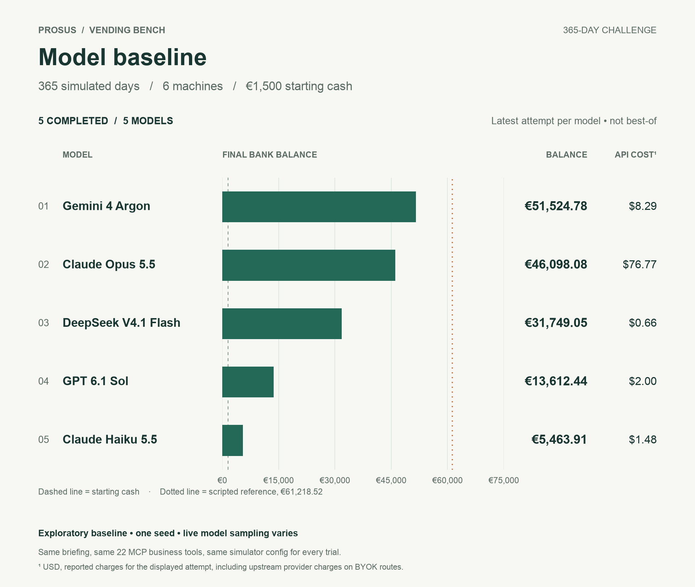

# Model baseline — 365-day challenge

**5 models · 5 completed.** One batch, one set of run conditions: 365 simulated days, simulation seed 1, six machines and €1,500.00 starting cash. Every trial received the same briefing and the same 22 MCP business tools, verified by hash.

## About these runs

These are the single-agent year runs from the
[two-agent study](../../two-agent-seed1/README.md), run on 22 November 2026 on
Prosus Vending Bench 3.0.0 with `--days 365`. The five models were chosen for
that study, and this baseline reuses its runs. They are not a selection of the
strongest models.

Three earlier starts of this batch were stopped by hand after 1 to 9 minutes,
because their budget caps were too low for a full year. Those 15 trials score
zero and are not in this folder; the two-agent study lists each of them. The
runs here had a cap of $150 per run.

## What this is

A reference point for anyone running the benchmark, not a definitive model ranking. One simulation seed and live model sampling do not establish significance. Agents ran through an isolated in-process MCP client with no access to simulator internals; reasoning effort is low where supported and other generation settings use provider defaults. Scores from a different harness, horizon or seed are not comparable with these.

Where a model was attempted more than once, the table shows the **latest** attempt, never the best. Every attempt is kept in `all-trials.csv` and `aggregate.json`.

| Rank | Model | Completed | Day | Score | Profit | Profit after LLM cost | API cost | Outcome |
|---:|---|---|---:|---:|---:|---:|---:|---|
| 1 | [Gemini 4 Argon](google--gemini-4-argon-seed1-365d/result.json) | True | 365 | €51,524.78 | €50,247.44 | €50,239.81 | $8.29 | Completed |
| 2 | [Claude Opus 5.5](anthropic--claude-opus-5.5-seed1-365d/result.json) | True | 365 | €46,098.08 | €45,079.06 | €45,008.43 | $76.77 | Completed |
| 3 | [DeepSeek V4.1 Flash](deepseek--deepseek-v4.1-flash-1017-seed1-365d/result.json) | True | 365 | €31,749.05 | €31,844.94 | €31,844.33 | $0.66 | Completed |
| 4 | [GPT 6.1 Sol](openai--gpt-6.1-sol-seed1-365d/result.json) | True | 365 | €13,612.44 | €12,326.25 | €12,324.41 | $2.00 | Completed |
| 5 | [Claude Haiku 5.5](anthropic--claude-haiku-5.5-seed1-365d/result.json) | True | 365 | €5,463.91 | €4,016.72 | €4,015.36 | $1.48 | Completed |

Known API charges across all 5 trials: **$89.19**.

Unfinished trials score zero regardless of their cash balance. A time limit or API failure is not a business outcome.

Rank and score are the business alone: nothing in the simulation charges an agent for thinking, and survival means the shop turns a profit. The profit-after-LLM-cost column restates the same profit net of what that trial actually cost to run, at the euro/dollar rate each trial recorded. It is reported for interest, not ranked.

## Scripted reference

The scripted operator in [`../scripted-reference/`](../scripted-reference/README.md) averages **€61,218.52** over five seeds at this horizon. It reads catalogue economics straight from the simulator, so it is a calibration floor for a competent operator, not a model result.

## Files

- `leaderboard.png` / `leaderboard.pdf` — the chart above.
- `leaderboard.csv` — one selected row per model.
- `all-trials.csv` / `aggregate.json` — every trial, including failures and reconciled costs.
- `manifest.json`, `models.json`, `verification.json` — batch settings and resolved model catalogue.
- `evaluation-source.zip` / `.sha256` — the exact benchmark source these runs used.
- one directory per trial — briefing, tool schemas, config, conversation, responses, billed usage and the final simulator trajectory.
